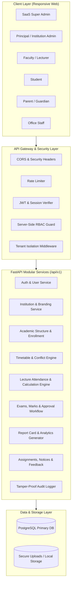

# PHILOMATRIX SOFTWARE — MASTER ARCHITECTURE SPECIFICATION
**Version:** 1.0.0  
**Target:** Indian Junior Colleges (Class 11 & 12 Science initial, extensible to Commerce & Arts)  
**System Type:** Multi-Tenant Educational ERP SaaS  

---

## 1. SYSTEM OVERVIEW & CORE PHILOSOPHY

PHILOMATRIX SOFTWARE is an enterprise-grade, multi-institution Junior College Educational Resource Planning (ERP) platform. Junior Colleges in India operate under distinct operational dynamics compared to standard K-12 schools or multi-year universities:
- High lecture frequency across divided practical batches and theory divisions (Physics, Chemistry, Mathematics, Biology, Computer Science, Electronics, English).
- Bi-weekly/monthly assessment cycles (Unit Tests, Terminals, Practicals, Prelims) with theory and laboratory components.
- Stringent mandatory attendance criteria (minimum 75% requirement under State Board/CBSE norms).
- Direct stakeholder visibility requirements: Students need immediate clarity on their attendance percentages and marks; parents need real-time absence visibility and verifiable report cards; faculty require quick period-by-period attendance entry and draft/submit marks workflows; principals require oversight, approval authority, and tamper-evident audit logging.

### Architectural Core Principles
1. **Strict Multi-Tenant Isolation:** Every institution's data is isolated logically by `institution_id` with row-level scoping on all queries and operations. Cross-institution data leakage is prevented at the database and API middleware levels.
2. **Immutable Audit Trails & Approval Governance:** Sensitive academic records (attendance, marks, result publications) cannot be silently overwritten. Any retroactive change requires a formal correction request, reason, and Principal approval.
3. **Decoupled Three-Tier Architecture:** 
   - **Frontend:** Modern Single Page Application (SPA) built with React 19, TypeScript (strict mode), Vite, Tailwind CSS, TanStack Query for caching and server state, React Hook Form + Zod for runtime schema validation.
   - **Backend:** High-performance RESTful API using Python 3.12, FastAPI, Pydantic v2 schemas, SQLAlchemy 2.0 ORM, and Alembic migrations.
   - **Database:** PostgreSQL (with SQLite compatibility for lightning-fast localized test execution).
4. **Defense-in-Depth Security:** Short-lived JWT access tokens + secure refresh tokens, Argon2id/bcrypt password hashing, server-side RBAC, rate-limiting on sensitive endpoints, secure file storage with signed streaming, and input sanitization.

---

## 2. SCOPE SPECIFICATION (VERSION 1)

### 2.1 In Scope for Version 1
- **Multi-Tenant Administration:** SaaS Super Admin portal for institution provisioning, lifecycle control, and system health monitoring.
- **Academic Hierarchy:** Academic years, Classes (Class 11, Class 12), Sections/Divisions (A, B, C, etc.), Streams (Science default; configurable for Commerce/Arts), Subjects (Theory/Practical codes, credit hours).
- **Faculty & Workload Allocation:** Faculty profiles, subject-division-lecture assignments, and class-teacher designations.
- **Student & Guardian Records:** Unique admission numbers, detailed profile management, class-division enrollment, verified parent-student linking, and multi-child parent switcher.
- **Conflict-Aware Timetable:** Day-of-week, period-wise schedule with automatic clash detection (faculty conflict, division conflict, room clash).
- **Lecture-Wise Attendance System:** Real-time period attendance marking (Present, Absent, Late, Excused), instant attendance percentage calculation, absence tracking, and Principal-approved correction requests.
- **Exams, Marks & Moderation:** Configurable exam categories (Unit Tests, Practicals, Terminals, Prelims), theory & practical marks entry by assigned teachers, draft/submit workflow, Principal review/approval/rejection, and final result publication.
- **Dynamic Report Cards & Performance Analytics:** PDF report cards with institution branding, subject-wise breakdown, attendance integration, teacher remarks, authorized signatures, class averages, and at-risk student flags.
- **Academic Assignments & Homework:** Assignment dispatch by subject faculty, deadline tracking, attachment downloads, and student submission states.
- **Notices, Events & Announcements:** Multi-targeted bulletin board (All, Faculty, Class, Division, Parents).
- **Academic Feedback System:** Anonymous/identified structured feedback sessions with rating scales and aggregated analytics.
- **Notification Engine & Audit Logging:** In-app event alerts and tamper-resistant audit logs tracking all administrative interventions.

### 2.2 Excluded from Version 1 (Roadmapped for V2+)
- Fee collection, fee tracking, invoices, and online payment gateways.
- Employee payroll, salary slips, and HR provident fund accounting.
- Hostel boarding allocation and mess billing.
- Transport bus fleet routing and GPS tracking.
- Library book circulation and catalog management.
- Native mobile applications (iOS/Android) — standard responsive web PWA/mobile view is provided.

---

## 3. HIGH-LEVEL SYSTEM ARCHITECTURE

---

## 4. TENANT ISOLATION MODEL

Multi-tenancy in PHILOMATRIX is implemented using **logical row-level segregation** within a shared database instance:
1. Every institution-specific table contains an indexed foreign key: `institution_id UUID NOT NULL REFERENCES institutions(id) ON DELETE CASCADE`.
2. The authenticated user's token carries their verified `institution_id` and assigned roles.
3. Every repository and service query enforces `.where(Model.institution_id == current_user.institution_id)` automatically via base repository helpers or explicit query filtering.
4. SaaS Super Admins can switch context or manage institutions globally, while institutional users are strictly locked to their single tenant domain.

---

## 5. SECURITY & COMPLIANCE SPECIFICATION

- **Password Hashing:** Passwords hashed with standard Argon2id or bcrypt (cost factor >= 12).
- **Session Tokens:** Stateless short-lived JWT Access Tokens (15–30 min expiration) accompanied by secure HTTP-only refresh tokens stored in database with rotation and revocation capabilities.
- **Authorization:** Granular permissions checked per endpoint using dependency injection (`require_permission("attendance:approve")` / `require_role(Role.PRINCIPAL)`).
- **Audit Logging:** Every modification to student marks, attendance corrections, and user role grants records `actor_id`, `action`, `resource_type`, `resource_id`, `before_state`, `after_state`, `ip_address`, and `timestamp`.
- **Zero Exposure:** Student passwords, hashes, and private tokens are never returned in serialization schemas or logged to stdout.
