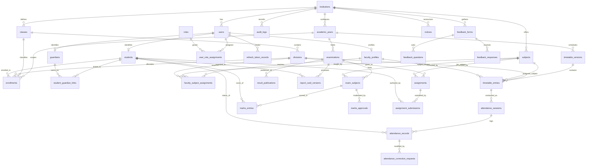

# PHILOMATRIX SOFTWARE — DATABASE DESIGN & DATA MODEL SPECIFICATION
**Document Version:** 1.0.0  
**RDBMS:** PostgreSQL 15+ (SQLAlchemy 2.0 ORM + Alembic)  

---

## 1. ENTITY RELATIONSHIP DIAGRAM (MERMAID)

---

## 2. CORE TABLE SPECIFICATIONS

### 2.1 Multi-Tenancy & Platform Entities

#### `institutions`
- `id` (UUID, Primary Key, default `gen_random_uuid()`)
- `slug` (VARCHAR(64), UNIQUE, Indexed) — e.g. `royal-science-jc`
- `name` (VARCHAR(255), NOT NULL) — e.g. "Royal Junior College of Science"
- `code` (VARCHAR(32), UNIQUE, NOT NULL) — e.g. "RJCS-001"
- `status` (VARCHAR(20), NOT NULL, default 'ACTIVE') — 'ACTIVE', 'SUSPENDED', 'DEACTIVATED'
- `address` (TEXT)
- `city` (VARCHAR(100)), `state` (VARCHAR(100)), `pincode` (VARCHAR(20))
- `phone` (VARCHAR(30)), `email` (VARCHAR(255))
- `logo_url` (TEXT)
- `created_at` (TIMESTAMP WITH TIME ZONE, NOT NULL, default `NOW()`)
- `updated_at` (TIMESTAMP WITH TIME ZONE, NOT NULL, default `NOW()`)

#### `institution_settings`
- `id` (UUID, Primary Key)
- `institution_id` (UUID, FOREIGN KEY -> institutions.id, UNIQUE, ON DELETE CASCADE)
- `min_attendance_threshold` (NUMERIC(5,2), default 75.00)
- `grading_scale` (JSONB, default standard Maharashtra/CBSE grading: Distinction, First Class, Second Class, Pass)
- `allow_late_as_present` (BOOLEAN, default TRUE)
- `enable_parent_sms_alerts` (BOOLEAN, default FALSE)
- `report_card_template_id` (VARCHAR(50), default 'STANDARD_V1')

---

### 2.2 Identity & Role-Based Access Control (RBAC)

#### `users`
- `id` (UUID, Primary Key)
- `institution_id` (UUID, NULLABLE -> NULL for global Super Admins, FOREIGN KEY -> institutions.id)
- `username` (VARCHAR(100), UNIQUE, NOT NULL, Indexed)
- `email` (VARCHAR(255), UNIQUE, NOT NULL, Indexed)
- `password_hash` (VARCHAR(255), NOT NULL) — Argon2id hash
- `first_name` (VARCHAR(100), NOT NULL)
- `last_name` (VARCHAR(100), NOT NULL)
- `phone_number` (VARCHAR(30))
- `is_active` (BOOLEAN, default TRUE)
- `is_verified` (BOOLEAN, default TRUE)
- `created_at` (TIMESTAMP WITH TIME ZONE, default `NOW()`)
- `updated_at` (TIMESTAMP WITH TIME ZONE, default `NOW()`)
- `last_login_at` (TIMESTAMP WITH TIME ZONE)

#### `roles`
- `id` (UUID, Primary Key)
- `name` (VARCHAR(50), UNIQUE, NOT NULL) — 'SUPER_ADMIN', 'PRINCIPAL', 'FACULTY', 'STUDENT', 'PARENT', 'OFFICE_STAFF'
- `description` (TEXT)

#### `user_role_assignments`
- `id` (UUID, Primary Key)
- `user_id` (UUID, FOREIGN KEY -> users.id, ON DELETE CASCADE)
- `role_id` (UUID, FOREIGN KEY -> roles.id, ON DELETE CASCADE)
- `institution_id` (UUID, FOREIGN KEY -> institutions.id, ON DELETE CASCADE)
- UNIQUE constraint: `(user_id, role_id, institution_id)`

#### `refresh_token_records`
- `id` (UUID, Primary Key)
- `user_id` (UUID, FOREIGN KEY -> users.id, ON DELETE CASCADE)
- `token_hash` (VARCHAR(255), NOT NULL, UNIQUE, Indexed)
- `expires_at` (TIMESTAMP WITH TIME ZONE, NOT NULL)
- `is_revoked` (BOOLEAN, default FALSE)
- `created_at` (TIMESTAMP WITH TIME ZONE, default `NOW()`)

---

### 2.3 Academic Structures

#### `academic_years`
- `id` (UUID, Primary Key)
- `institution_id` (UUID, FOREIGN KEY -> institutions.id, ON DELETE CASCADE)
- `name` (VARCHAR(50), NOT NULL) — e.g. "2026-2027"
- `start_date` (DATE, NOT NULL)
- `end_date` (DATE, NOT NULL)
- `is_current` (BOOLEAN, default FALSE)
- `is_archived` (BOOLEAN, default FALSE)
- UNIQUE: `(institution_id, name)`

#### `classes`
- `id` (UUID, Primary Key)
- `institution_id` (UUID, FOREIGN KEY -> institutions.id, ON DELETE CASCADE)
- `name` (VARCHAR(50), NOT NULL) — e.g. "Class 11", "Class 12"
- `stream` (VARCHAR(50), default 'SCIENCE') — 'SCIENCE', 'COMMERCE', 'ARTS'
- `display_order` (INT, default 1)
- UNIQUE: `(institution_id, name, stream)`

#### `divisions`
- `id` (UUID, Primary Key)
- `institution_id` (UUID, FOREIGN KEY -> institutions.id, ON DELETE CASCADE)
- `class_id` (UUID, FOREIGN KEY -> classes.id, ON DELETE CASCADE)
- `name` (VARCHAR(10), NOT NULL) — e.g. "A", "B", "C", "Div-1"
- `room_number` (VARCHAR(50))
- `capacity` (INT, default 60)
- UNIQUE: `(class_id, name)`

#### `subjects`
- `id` (UUID, Primary Key)
- `institution_id` (UUID, FOREIGN KEY -> institutions.id, ON DELETE CASCADE)
- `code` (VARCHAR(20), NOT NULL) — e.g. "PHY-101", "CHEM-101", "MATH-101", "BIO-101", "ENG-101", "CS-101"
- `name` (VARCHAR(100), NOT NULL) — e.g. "Physics", "Chemistry"
- `stream` (VARCHAR(50), default 'SCIENCE')
- `has_practical` (BOOLEAN, default TRUE)
- `max_theory_marks` (NUMERIC(5,2), default 70.00)
- `max_practical_marks` (NUMERIC(5,2), default 30.00)
- `min_pass_percentage` (NUMERIC(5,2), default 35.00)
- UNIQUE: `(institution_id, code)`

---

### 2.4 Faculty & Subject Workload Allocations

#### `faculty_profiles`
- `id` (UUID, Primary Key)
- `user_id` (UUID, FOREIGN KEY -> users.id, UNIQUE, ON DELETE CASCADE)
- `institution_id` (UUID, FOREIGN KEY -> institutions.id, ON DELETE CASCADE)
- `employee_id` (VARCHAR(50), NOT NULL)
- `designation` (VARCHAR(100), default 'Lecturer')
- `department` (VARCHAR(100), default 'Science')
- `qualification` (VARCHAR(200))
- `joining_date` (DATE)
- UNIQUE: `(institution_id, employee_id)`

#### `faculty_subject_assignments`
- `id` (UUID, Primary Key)
- `institution_id` (UUID, FOREIGN KEY -> institutions.id, ON DELETE CASCADE)
- `academic_year_id` (UUID, FOREIGN KEY -> academic_years.id, ON DELETE CASCADE)
- `faculty_id` (UUID, FOREIGN KEY -> faculty_profiles.id, ON DELETE CASCADE)
- `subject_id` (UUID, FOREIGN KEY -> subjects.id, ON DELETE CASCADE)
- `division_id` (UUID, FOREIGN KEY -> divisions.id, ON DELETE CASCADE)
- `is_class_teacher` (BOOLEAN, default FALSE)
- UNIQUE: `(academic_year_id, faculty_id, subject_id, division_id)`

---

### 2.5 Students, Guardians & Enrollments

#### `students`
- `id` (UUID, Primary Key)
- `user_id` (UUID, FOREIGN KEY -> users.id, UNIQUE, ON DELETE CASCADE)
- `institution_id` (UUID, FOREIGN KEY -> institutions.id, ON DELETE CASCADE)
- `admission_number` (VARCHAR(50), NOT NULL) — e.g. "ADM-2026-0042"
- `roll_number` (VARCHAR(20))
- `date_of_birth` (DATE, NOT NULL)
- `gender` (VARCHAR(20), NOT NULL) — 'MALE', 'FEMALE', 'OTHER'
- `blood_group` (VARCHAR(5))
- `admission_date` (DATE, NOT NULL)
- `address` (TEXT)
- `emergency_contact_name` (VARCHAR(100))
- `emergency_contact_phone` (VARCHAR(30))
- `status` (VARCHAR(20), default 'ACTIVE') — 'ACTIVE', 'INACTIVE', 'TRANSFERRED', 'GRADUATED'
- UNIQUE: `(institution_id, admission_number)`

#### `guardians`
- `id` (UUID, Primary Key)
- `user_id` (UUID, FOREIGN KEY -> users.id, UNIQUE, ON DELETE CASCADE)
- `institution_id` (UUID, FOREIGN KEY -> institutions.id, ON DELETE CASCADE)
- `relationship` (VARCHAR(50), NOT NULL) — 'FATHER', 'MOTHER', 'LEGAL_GUARDIAN'
- `occupation` (VARCHAR(100))
- `alternative_phone` (VARCHAR(30))

#### `student_guardian_links`
- `id` (UUID, Primary Key)
- `student_id` (UUID, FOREIGN KEY -> students.id, ON DELETE CASCADE)
- `guardian_id` (UUID, FOREIGN KEY -> guardians.id, ON DELETE CASCADE)
- `is_primary` (BOOLEAN, default TRUE)
- `is_verified` (BOOLEAN, default TRUE)
- UNIQUE: `(student_id, guardian_id)`

#### `enrollments`
- `id` (UUID, Primary Key)
- `institution_id` (UUID, FOREIGN KEY -> institutions.id, ON DELETE CASCADE)
- `student_id` (UUID, FOREIGN KEY -> students.id, ON DELETE CASCADE)
- `academic_year_id` (UUID, FOREIGN KEY -> academic_years.id, ON DELETE CASCADE)
- `class_id` (UUID, FOREIGN KEY -> classes.id, ON DELETE CASCADE)
- `division_id` (UUID, FOREIGN KEY -> divisions.id, ON DELETE CASCADE)
- `roll_number` (VARCHAR(20))
- `status` (VARCHAR(20), default 'ENROLLED') — 'ENROLLED', 'PROMOTED', 'DETAINED', 'WITHDRAWN'
- UNIQUE: `(academic_year_id, student_id)`

---

### 2.6 Timetable & Scheduling

#### `timetable_versions`
- `id` (UUID, Primary Key)
- `institution_id` (UUID, FOREIGN KEY -> institutions.id, ON DELETE CASCADE)
- `academic_year_id` (UUID, FOREIGN KEY -> academic_years.id, ON DELETE CASCADE)
- `version_number` (INT, default 1)
- `is_active` (BOOLEAN, default TRUE)
- `effective_from` (DATE, NOT NULL)

#### `timetable_entries`
- `id` (UUID, Primary Key)
- `timetable_version_id` (UUID, FOREIGN KEY -> timetable_versions.id, ON DELETE CASCADE)
- `institution_id` (UUID, FOREIGN KEY -> institutions.id, ON DELETE CASCADE)
- `division_id` (UUID, FOREIGN KEY -> divisions.id, ON DELETE CASCADE)
- `subject_id` (UUID, FOREIGN KEY -> subjects.id, ON DELETE CASCADE)
- `faculty_id` (UUID, FOREIGN KEY -> faculty_profiles.id, ON DELETE CASCADE)
- `day_of_week` (SMALLINT, NOT NULL) — 1 (Monday) to 6 (Saturday)
- `period_number` (SMALLINT, NOT NULL) — 1 to 8
- `start_time` (TIME, NOT NULL)
- `end_time` (TIME, NOT NULL)
- `room_number` (VARCHAR(50))
- `is_practical_batch` (BOOLEAN, default FALSE)
- `batch_name` (VARCHAR(20)) — e.g. "B1", "B2" (NULL for regular class)
- CONSTRAINTS: Conflict validation triggers or uniqueness on `(timetable_version_id, faculty_id, day_of_week, period_number)` and `(timetable_version_id, division_id, day_of_week, period_number)`.

---

### 2.7 Attendance Sessions & Corrections

#### `attendance_sessions`
- `id` (UUID, Primary Key)
- `institution_id` (UUID, FOREIGN KEY -> institutions.id, ON DELETE CASCADE)
- `academic_year_id` (UUID, FOREIGN KEY -> academic_years.id, ON DELETE CASCADE)
- `timetable_entry_id` (UUID, NULLABLE, FOREIGN KEY -> timetable_entries.id)
- `division_id` (UUID, FOREIGN KEY -> divisions.id, ON DELETE CASCADE)
- `subject_id` (UUID, FOREIGN KEY -> subjects.id, ON DELETE CASCADE)
- `faculty_id` (UUID, FOREIGN KEY -> faculty_profiles.id, ON DELETE CASCADE)
- `session_date` (DATE, NOT NULL)
- `period_number` (SMALLINT, NOT NULL)
- `submission_status` (VARCHAR(20), default 'SUBMITTED') — 'SUBMITTED', 'CANCELLED'
- `submitted_at` (TIMESTAMP WITH TIME ZONE, default `NOW()`)
- UNIQUE: `(division_id, subject_id, session_date, period_number)`

#### `attendance_records`
- `id` (UUID, Primary Key)
- `attendance_session_id` (UUID, FOREIGN KEY -> attendance_sessions.id, ON DELETE CASCADE)
- `student_id` (UUID, FOREIGN KEY -> students.id, ON DELETE CASCADE)
- `status` (VARCHAR(20), NOT NULL) — 'PRESENT', 'ABSENT', 'LATE', 'EXCUSED'
- `remarks` (VARCHAR(255))
- UNIQUE: `(attendance_session_id, student_id)`

#### `attendance_correction_requests`
- `id` (UUID, Primary Key)
- `attendance_record_id` (UUID, FOREIGN KEY -> attendance_records.id, ON DELETE CASCADE)
- `requested_by` (UUID, FOREIGN KEY -> users.id)
- `previous_status` (VARCHAR(20), NOT NULL)
- `requested_status` (VARCHAR(20), NOT NULL)
- `reason` (TEXT, NOT NULL)
- `status` (VARCHAR(20), default 'PENDING') — 'PENDING', 'APPROVED', 'REJECTED'
- `reviewed_by` (UUID, NULLABLE, FOREIGN KEY -> users.id)
- `reviewed_at` (TIMESTAMP WITH TIME ZONE)
- `review_notes` (TEXT)
- `created_at` (TIMESTAMP WITH TIME ZONE, default `NOW()`)

---

### 2.8 Examinations, Marks & Moderation

#### `examinations`
- `id` (UUID, Primary Key)
- `institution_id` (UUID, FOREIGN KEY -> institutions.id, ON DELETE CASCADE)
- `academic_year_id` (UUID, FOREIGN KEY -> academic_years.id, ON DELETE CASCADE)
- `name` (VARCHAR(100), NOT NULL) — e.g. "Unit Test 1", "First Terminal Exam", "Annual Board Mock"
- `exam_type` (VARCHAR(50), NOT NULL) — 'UNIT_TEST', 'TERMINAL', 'PRACTICAL', 'PRELIM', 'FINAL'
- `start_date` (DATE, NOT NULL)
- `end_date` (DATE, NOT NULL)
- `status` (VARCHAR(20), default 'DRAFT') — 'DRAFT', 'SCHEDULED', 'MARKS_ENTRY', 'UNDER_REVIEW', 'PUBLISHED'

#### `exam_subjects`
- `id` (UUID, Primary Key)
- `examination_id` (UUID, FOREIGN KEY -> examinations.id, ON DELETE CASCADE)
- `subject_id` (UUID, FOREIGN KEY -> subjects.id, ON DELETE CASCADE)
- `class_id` (UUID, FOREIGN KEY -> classes.id, ON DELETE CASCADE)
- `max_theory_marks` (NUMERIC(5,2), NOT NULL)
- `max_practical_marks` (NUMERIC(5,2), default 0.00)
- `min_passing_marks` (NUMERIC(5,2), NOT NULL)
- `exam_date` (DATE)
- UNIQUE: `(examination_id, subject_id, class_id)`

#### `marks_entries`
- `id` (UUID, Primary Key)
- `exam_subject_id` (UUID, FOREIGN KEY -> exam_subjects.id, ON DELETE CASCADE)
- `student_id` (UUID, FOREIGN KEY -> students.id, ON DELETE CASCADE)
- `theory_marks_obtained` (NUMERIC(5,2))
- `practical_marks_obtained` (NUMERIC(5,2))
- `total_obtained` (NUMERIC(5,2))
- `is_absent` (BOOLEAN, default FALSE)
- `is_exempt` (BOOLEAN, default FALSE)
- `entered_by` (UUID, FOREIGN KEY -> users.id)
- `status` (VARCHAR(20), default 'DRAFT') — 'DRAFT', 'SUBMITTED', 'APPROVED', 'REJECTED'
- `teacher_remarks` (VARCHAR(255))
- UNIQUE: `(exam_subject_id, student_id)`

#### `marks_approvals`
- `id` (UUID, Primary Key)
- `exam_subject_id` (UUID, FOREIGN KEY -> exam_subjects.id, ON DELETE CASCADE)
- `division_id` (UUID, FOREIGN KEY -> divisions.id, ON DELETE CASCADE)
- `submitted_by` (UUID, FOREIGN KEY -> users.id)
- `submitted_at` (TIMESTAMP WITH TIME ZONE, default `NOW()`)
- `status` (VARCHAR(20), default 'PENDING') — 'PENDING', 'APPROVED', 'REJECTED'
- `reviewed_by` (UUID, NULLABLE, FOREIGN KEY -> users.id)
- `reviewed_at` (TIMESTAMP WITH TIME ZONE)
- `review_comments` (TEXT)
- UNIQUE: `(exam_subject_id, division_id)`

#### `result_publications`
- `id` (UUID, Primary Key)
- `examination_id` (UUID, FOREIGN KEY -> examinations.id, ON DELETE CASCADE)
- `class_id` (UUID, FOREIGN KEY -> classes.id, ON DELETE CASCADE)
- `published_by` (UUID, FOREIGN KEY -> users.id)
- `published_at` (TIMESTAMP WITH TIME ZONE, default `NOW()`)
- `is_active` (BOOLEAN, default TRUE)
- UNIQUE: `(examination_id, class_id)`

#### `report_card_versions`
- `id` (UUID, Primary Key)
- `institution_id` (UUID, FOREIGN KEY -> institutions.id, ON DELETE CASCADE)
- `examination_id` (UUID, FOREIGN KEY -> examinations.id, ON DELETE CASCADE)
- `student_id` (UUID, FOREIGN KEY -> students.id, ON DELETE CASCADE)
- `version` (INT, default 1)
- `summary_data` (JSONB, NOT NULL) — Snapshot of subjects, scores, totals, percentages, attendance, remarks
- `generated_at` (TIMESTAMP WITH TIME ZONE, default `NOW()`)
- `generated_by` (UUID, FOREIGN KEY -> users.id)

---

### 2.9 Communication, Feedback & Audit

#### `assignments`
- `id` (UUID, Primary Key)
- `institution_id` (UUID, FOREIGN KEY -> institutions.id, ON DELETE CASCADE)
- `division_id` (UUID, FOREIGN KEY -> divisions.id, ON DELETE CASCADE)
- `subject_id` (UUID, FOREIGN KEY -> subjects.id, ON DELETE CASCADE)
- `faculty_id` (UUID, FOREIGN KEY -> faculty_profiles.id, ON DELETE CASCADE)
- `title` (VARCHAR(255), NOT NULL)
- `description` (TEXT)
- `due_date` (TIMESTAMP WITH TIME ZONE, NOT NULL)
- `attachment_url` (TEXT)
- `created_at` (TIMESTAMP WITH TIME ZONE, default `NOW()`)

#### `assignment_submissions`
- `id` (UUID, Primary Key)
- `assignment_id` (UUID, FOREIGN KEY -> assignments.id, ON DELETE CASCADE)
- `student_id` (UUID, FOREIGN KEY -> students.id, ON DELETE CASCADE)
- `submission_text` (TEXT)
- `attachment_url` (TEXT)
- `submitted_at` (TIMESTAMP WITH TIME ZONE, default `NOW()`)
- `is_late` (BOOLEAN, default FALSE)
- `status` (VARCHAR(20), default 'SUBMITTED') — 'SUBMITTED', 'REVIEWED'
- `grade_or_score` (VARCHAR(20))
- `feedback_remarks` (TEXT)
- UNIQUE: `(assignment_id, student_id)`

#### `notices`
- `id` (UUID, Primary Key)
- `institution_id` (UUID, FOREIGN KEY -> institutions.id, ON DELETE CASCADE)
- `title` (VARCHAR(255), NOT NULL)
- `content` (TEXT, NOT NULL)
- `audience_role` (VARCHAR(50), default 'ALL') — 'ALL', 'FACULTY', 'STUDENTS', 'PARENTS'
- `target_class_id` (UUID, NULLABLE, FOREIGN KEY -> classes.id)
- `target_division_id` (UUID, NULLABLE, FOREIGN KEY -> divisions.id)
- `priority` (VARCHAR(20), default 'NORMAL') — 'LOW', 'NORMAL', 'URGENT'
- `published_by` (UUID, FOREIGN KEY -> users.id)
- `is_published` (BOOLEAN, default TRUE)
- `expires_at` (DATE)
- `created_at` (TIMESTAMP WITH TIME ZONE, default `NOW()`)

#### `feedback_forms`
- `id` (UUID, Primary Key)
- `institution_id` (UUID, FOREIGN KEY -> institutions.id, ON DELETE CASCADE)
- `title` (VARCHAR(255), NOT NULL)
- `target_role` (VARCHAR(50), default 'STUDENT')
- `is_anonymous` (BOOLEAN, default TRUE)
- `is_open` (BOOLEAN, default TRUE)
- `start_date` (DATE)
- `end_date` (DATE)

#### `feedback_questions`
- `id` (UUID, Primary Key)
- `feedback_form_id` (UUID, FOREIGN KEY -> feedback_forms.id, ON DELETE CASCADE)
- `question_text` (TEXT, NOT NULL)
- `question_type` (VARCHAR(20), default 'RATING_1_5') — 'RATING_1_5', 'TEXT'
- `display_order` (INT, default 1)

#### `feedback_responses`
- `id` (UUID, Primary Key)
- `feedback_form_id` (UUID, FOREIGN KEY -> feedback_forms.id, ON DELETE CASCADE)
- `question_id` (UUID, FOREIGN KEY -> feedback_questions.id, ON DELETE CASCADE)
- `respondent_user_id` (UUID, NULLABLE -> NULL when is_anonymous is TRUE)
- `rating_value` (SMALLINT)
- `text_response` (TEXT)
- `submitted_at` (TIMESTAMP WITH TIME ZONE, default `NOW()`)

#### `audit_logs`
- `id` (UUID, Primary Key)
- `institution_id` (UUID, NULLABLE, FOREIGN KEY -> institutions.id)
- `user_id` (UUID, NULLABLE, FOREIGN KEY -> users.id)
- `action` (VARCHAR(100), NOT NULL) — e.g. "MARKS_APPROVED", "ATTENDANCE_CORRECTED", "USER_PROMOTED"
- `entity_type` (VARCHAR(100), NOT NULL) — e.g. "attendance_records", "marks_entries"
- `entity_id` (VARCHAR(100), NOT NULL)
- `previous_state` (JSONB)
- `new_state` (JSONB)
- `reason` (TEXT)
- `ip_address` (VARCHAR(45))
- `created_at` (TIMESTAMP WITH TIME ZONE, default `NOW()`)
