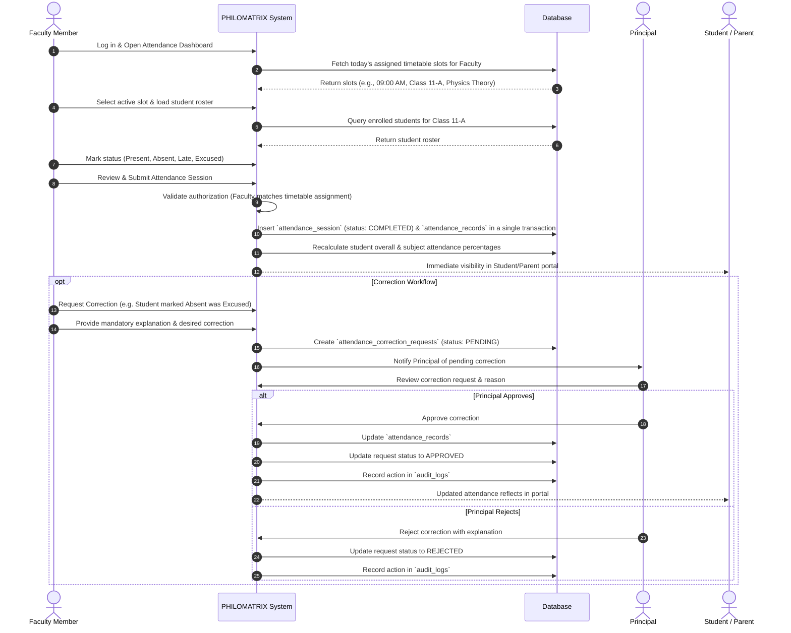
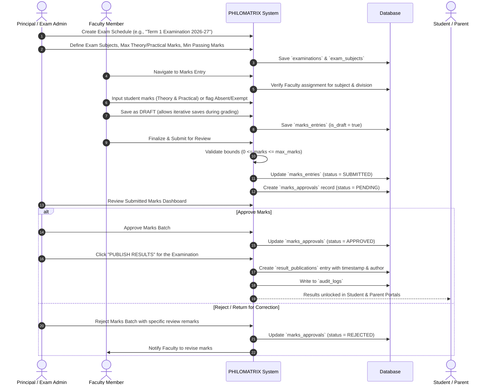

# PHILOMATRIX SOFTWARE — MASTER OPERATIONAL WORKFLOWS
**Document Version:** 1.0.0  

---

## 1. LECTURE-WISE ATTENDANCE WORKFLOW

### Attendance Formula & Computation Standard
$$\text{Attendance Percentage} = \left(\frac{\text{Attended Eligible Lectures}}{\text{Total Conducted Eligible Lectures}}\right) \times 100$$
- **Present:** Counts as 1 conducted, 1 attended.
- **Late:** Configurable per institution (default: counts as Present with late flag).
- **Excused (Authorized Medical/Sports Leave):** Deducted from total conducted denominator or counted as attended per institution policy (default: neutral/deducted from required pool so student percentage is not penalized).
- **Absent:** Counts as 1 conducted, 0 attended.
- **Unconducted / Pending Sessions:** NEVER counted as absence.

---

## 2. EXAMINATION, MARKS ENTRY & MODERATION WORKFLOW

---

## 3. REPORT CARD GENERATION & PUBLICATION

1. **Prerequisite Check:** Verification that all exam subjects for the selected class/division have `result_publications` in `PUBLISHED` status.
2. **Data Aggregation:**
   - Student demographic details (Admission No, Name, Roll No, Class, Division).
   - Subject-wise scores: Theory Marks Obtained / Max, Practical Marks Obtained / Max, Subject Total, Grade.
   - Aggregate Score: Grand Total, Maximum Possible, Overall Percentage, Overall Class Rank (optional), Final Result (Distinction, First Class, Pass, Needs Support).
   - Term Attendance Summary: Total Conducted vs. Attended, Attendance %.
   - Class Teacher & Principal Remarks.
3. **Template & PDF Render:** Render clean, printable layout with official Junior College header, watermark, signature blocks, and QR verification hash.
4. **Distribution:** Accessible directly inside Student & Parent Portals, with one-click print or PDF download.

---

## 4. ACADEMIC YEAR ROLLOVER & STUDENT PROMOTION

1. **Archival:** The previous academic year (e.g., 2025-2026) is marked as `ARCHIVED`. All historical timetable, attendance, marks, and report card records remain permanently immutable.
2. **Promotion Execution:**
   - Eligible Class 11 Science students are promoted to Class 12 Science in the new Academic Year (e.g., 2026-2027).
   - Students repeating a class are re-enrolled into Class 11.
   - Class 12 graduating students are transitioned to `GRADUATED` status.
3. **New Timetable & Allocation:** Subject assignments and timetables are initialized for the new active academic year without affecting historical records.
